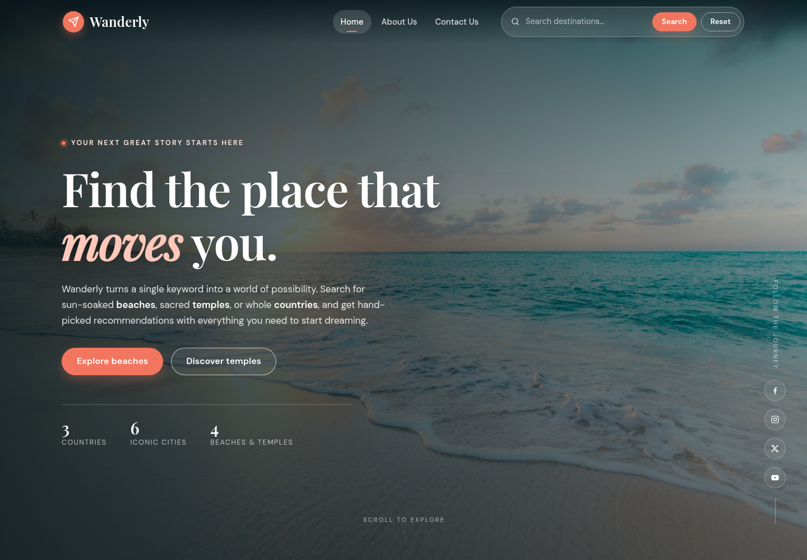

# Wanderly — Travel Recommendation Web Application

A responsive travel recommendation website built with **HTML, CSS, and vanilla JavaScript**.
Users can search a keyword such as **beach**, **temple**, or **country** and instantly see
recommendations with an image and a description. Country recommendations also show the
current local time for each destination.



## Project files

```
travelRecommendation/
├── travel_recommendation.html    # Home, About Us and Contact Us pages
├── styles.css                    # Layout, theme and responsive styles
├── travel_recommendation.js      # Fetch, keyword search, results, reset, local time
├── travel_recommendation_api.json # Destination data (countries / temples / beaches)
├── travel_recommendation.json    # Identical fallback copy of the data file
├── images/                       # All destination and hero images
├── screenshots/                  # Project screenshots (desktop + mobile)
└── README.md
```

## How to run

Because the page loads its data with `fetch()`, run it through a local web server instead
of opening the HTML file directly (`file://` blocks the request):

```bash
# from the project folder
python3 -m http.server 8000
```

Then open **http://localhost:8000/travel_recommendation.html**.

In VS Code you can also right-click `travel_recommendation.html` and choose
**Open with Live Server**.

## How to use

1. Type a keyword into the search bar in the navbar.
2. Click **Search** (results are shown only after the button is clicked).
3. Click **Reset** to clear the input and the results.
4. Use **Home**, **About Us**, and **Contact Us** to move between pages.

Supported keyword variations (case-insensitive and plural-friendly):

| Keyword | Results |
| --- | --- |
| `beach`, `beaches`, `Beach`, `BEACH` | Bora Bora, Copacabana Beach |
| `temple`, `temples`, `TEMPLE` | Angkor Wat, Taj Mahal |
| `country`, `countries`, `Country` | Sydney, Melbourne, Tokyo, Kyoto, Rio de Janeiro, São Paulo |
| A specific name, e.g. `Japan`, `Brazil`, `Tokyo`, `Angkor Wat` | Matching destination(s) |

Country results include a live local-time clock, for example:
`Local time in Japan: 2:24:25 AM`.

## Task checklist

| Task | Where it is implemented |
| --- | --- |
| 1. HTML template + `<title>` | `travel_recommendation.html` (`<html>`, `<head>`, `<body>`, `<title>Wanderly | Travel Recommendations</title>`) |
| 2. Navbar with Home / About Us / Contact Us, search bar, Search and Reset buttons | `travel_recommendation.html` → `<header class="site-header">`, styles in `styles.css` |
| 3. Home page with background image, introduction and social icons | `#home` hero section + `.hero-social` |
| 4. About Us page with company info and team names/roles; navbar without search | `#about` section; the search form is hidden on About Us and Contact Us |
| 5. Contact Us page with name, email, message and Submit | `#contact` section + validation in `travel_recommendation.js` |
| 6. Fetch JSON data with `fetch()` and log it | `loadTravelData()` — logs the full data set to the console |
| 7. Case-insensitive keyword variations | `normalise()`, `matchesGroup()`, `findRecommendations()` |
| 8. At least 2 results per keyword with image + description, CSS grid | `runSearch()`, `createCard()`, `.results-grid { display: grid; }` |
| 9. Reset/Clear button logic | `clearResults()` |
| 10. Country local date/time (optional) | `formatTime()`, `updateClocks()`, time zone data in the JSON |

## Screenshots

| | |
| --- | --- |
| **Home** | `screenshots/home.png` |
| **Beach results** | `screenshots/results-beach.png` |
| **Temple results** | `screenshots/results-temple.png` |
| **Country results + local time** | `screenshots/results-country.png` |
| **About Us** | `screenshots/about.png` |
| **Contact Us** | `screenshots/contact.png` |
| **Contact form success** | `screenshots/contact-success.png` |
| **Mobile home / menu / results** | `screenshots/mobile-home.png`, `mobile-menu.png`, `mobile-results.png` |

## Notes

- All images are stored locally in `images/` and referenced from the JSON file, so no
  external image hosting is required at runtime.
- The contact form is front-end only (no backend is part of this project); it validates
  the fields and shows a success message after submission.
- Image credits: destination photos from [Unsplash](https://unsplash.com) and
  [Wikimedia Commons](https://commons.wikimedia.org) (Angkor Wat and the Copacabana aerial view).
